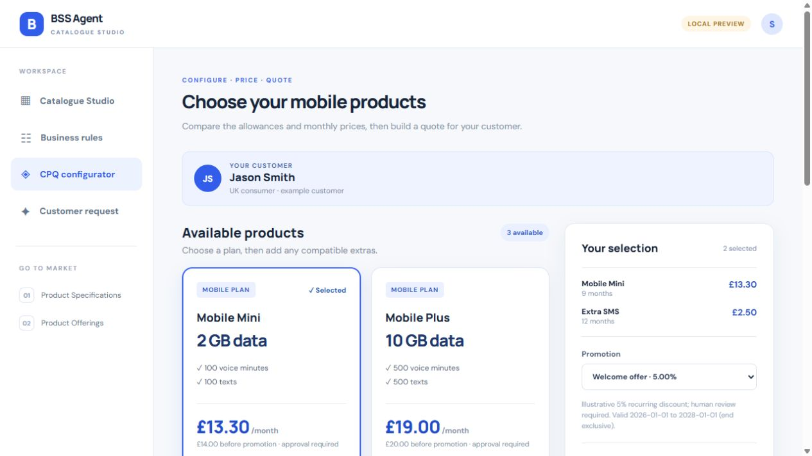
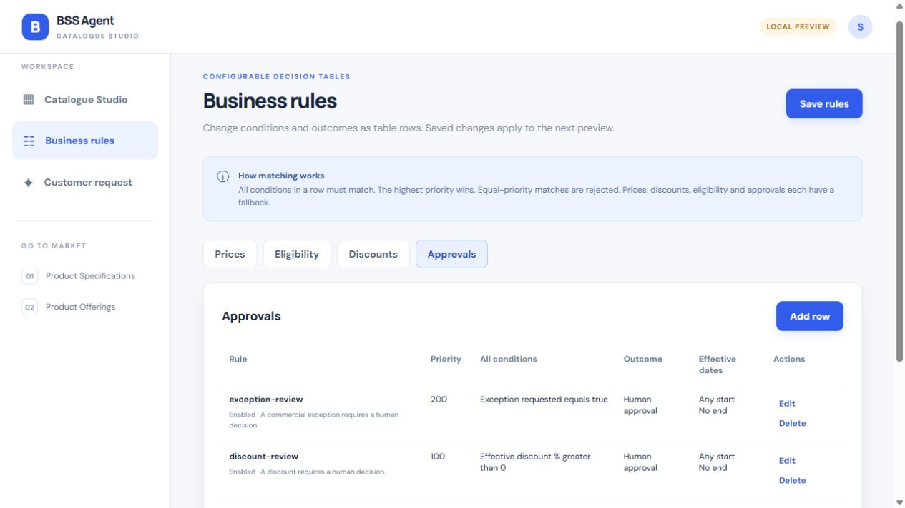
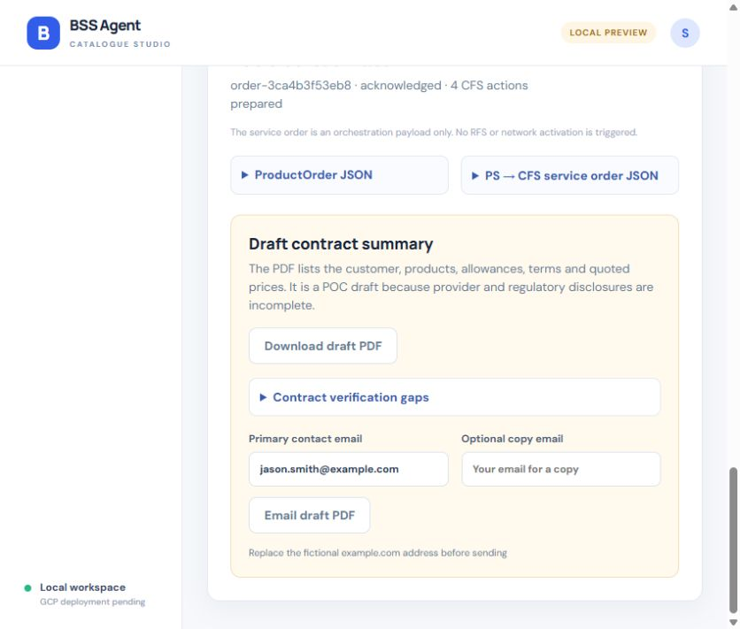
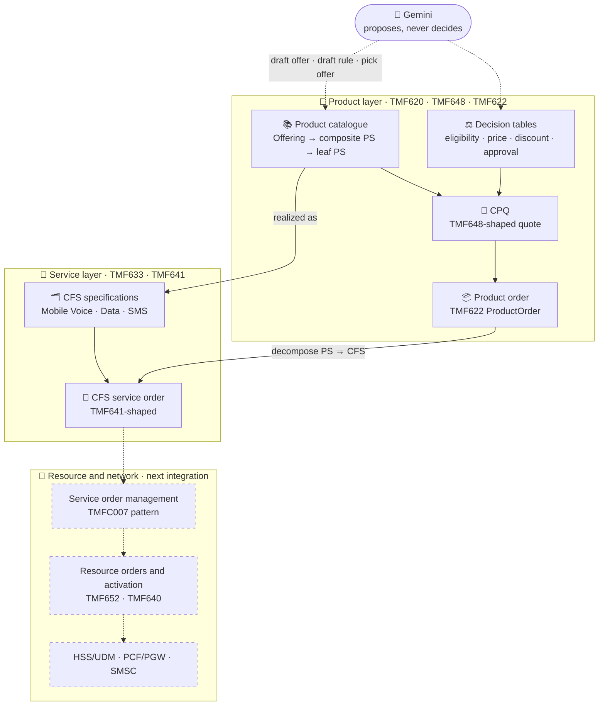
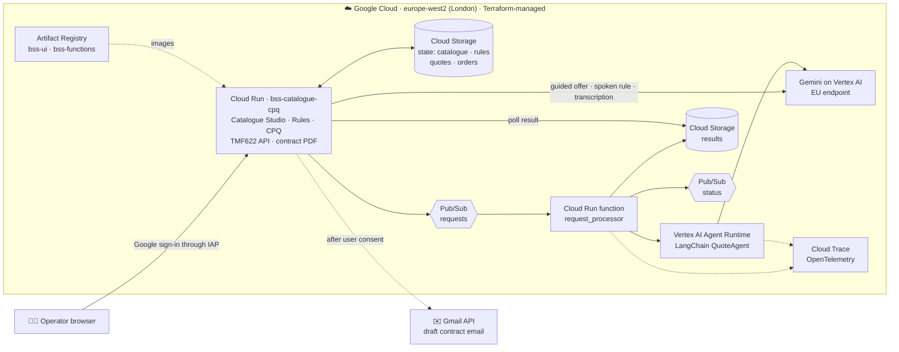
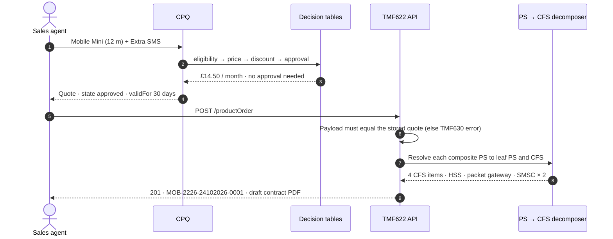

<div align="center">

# 📡 BSS AI Agent: Catalogue to Network on Google Cloud

**Launch a mobile plan in one step, set commercial rules by voice, and turn every order into a network-ready service order.**

A TM Forum ODA-patterned BSS proof of concept: reusable Product → CFS catalogue, configurable decision tables, CPQ, TMF622 ordering and TMF641-shaped decomposition, with Gemini as a guarded assistant.


### ▶️ [Watch the narrated walkthrough](https://sandesh113.github.io/BSS-GCP-Agent/)
<sub>11 scenes · about 4½ minutes · for telecom and BSS teams · hosted with GitHub Pages</sub>

</div>

---

## 📑 Contents

[At a glance](#-at-a-glance) · [The problem](#-the-problem) · [Demo](#-demo) · [Architecture](#%EF%B8%8F-architecture) · [Catalogue model](#-catalogue-model-10-ps--7-cfss) · [Rules](#%EF%B8%8F-configurable-rules) · [TM Forum alignment](#-tm-forum-alignment) · [Guardrails](#%EF%B8%8F-ai-proposes-code-decides) · [Quality](#-quality-and-evidence) · [Run it](#-run-it) · [Roadmap](#-roadmap) · [Docs](#-documentation)

---

## ✨ At a glance

| | |
| --- | --- |
| 🚀 **One-step go-to-market** | A product manager describes a plan (typed, spoken or drag-and-drop). The platform generates the Product Offering, the composite Product Specification and the inherited CFS realization. |
| ⚖️ **Rules without code** | Eligibility, price, discount and approval are lookup tables. Add a row or a new input column, or **say the rule out loud**; Gemini drafts it and the rules engine validates it. |
| 🧮 **CPQ that respects the catalogue** | Term pricing, product constraints, dated promotions and segment qualification produce a TMF648-shaped quote valid for 30 days. |
| 📦 **Network-ready orders** | A TMF622 ProductOrder is decomposed into a TMF641-shaped CFS service order with target system and operation for each service (HSS, packet gateway, SMSC). |
| 🤖 **AI that cannot overreach** | Gemini proposes; deterministic code validates every ID, price, unit and rule before anything is saved or sold. |
| ☁️ **Real cloud deployment** | Private Cloud Run, Pub/Sub, Vertex AI Agent Runtime and Cloud Storage, all provisioned with Terraform. |

---

## 🎯 The problem

Launching a new mobile plan usually needs three teams and several weeks. Product managers design the offer, IT encodes prices and rules, and service designers map it to the network. Every change risks a mismatch between what is sold and what the network provisions.

**Approach:** separate the layers the way TM Forum's SID and ODA do, and make each layer reusable.

```text
Service designers  ──►  build the PS → CFS realization once (dependencies, units, network targets)
Product managers   ──►  compose offers from those blocks; the CFS mapping is inherited, never retyped
Business owners    ──►  change prices, eligibility, discounts and approvals as table rows, or by voice
Every order        ──►  decomposes automatically into the CFS actions the network side needs
```

**Outcome in this POC:** a new offer goes from description to orderable in minutes, with publication blocked until every specification has a CFS mapping with matching units.

---

## 🎬 Demo

> 🎧 **[Narrated walkthrough: from product specification to network-ready service order](https://sandesh113.github.io/BSS-GCP-Agent/)**
> Animated scenes and real payloads, narrated with Google Gemini text-to-speech. Covers the 10 PS → 7 CFSS library, one-step launch, gated publication, decision tables, CPQ, the AI channel, TMF622 and TMF641 decomposition.
>
> 📁 A copy lives in [`demo/`](demo/README.md): open `demo/catalogue-to-network.html` locally with its recorded narration and the scripts that produced it.

| CPQ configurator | Business rules | Order and contract |
| :---: | :---: | :---: |
|  |  |  |
| Plan tiles, term pricing and promotions for a fictional UK customer | Four decision tables with priorities and effective dates | TMF622 order, CFS actions and a draft contract PDF |

Example payloads: [TMF622 ProductOrder](review/tmf622-product-order-example.json) · [CFS service order](review/cfs-service-order-example.json) · [draft contract PDF](review/draft-contract-summary.pdf)

---

## 🏗️ Architecture

### Functional view: TM Forum layers



<sub>Solid lines run today. Dashed boxes are the hand-off pattern the CFS service order is shaped for; network adapters are not part of this POC.</sub>

### Deployment view: Google Cloud



### Order journey



---

## 📚 Catalogue model: 10 PS → 7 CFSS

Product managers see **Product Specifications**. Service designers own the **CFS specifications** behind them (SID `ProductSpecRealizedAsCFSSpec`). Reuse is deliberate: one CFS can serve several products.

| Product specification | Realized as CFS | How | Status |
| --- | --- | --- | :---: |
| Mobile access | Mobile Line | create or reuse the primary line | 📐 |
| UK voice | Mobile Voice | domestic bucket | ✅ |
| UK SMS | Mobile SMS | SMS bucket | ✅ |
| UK data | Mobile Data | data bucket | ✅ |
| International calling | **Mobile Voice** (reused) | separate international bucket on the same voice instance | 📐 |
| Roaming | **Mobile Line** (amended) | updates the existing line profile; no new service | 📐 |
| Voicemail | Voicemail | requires Mobile Voice | 📐 |
| MMS | Mobile MMS | requires messaging/data bearer | 📐 |
| Smartwatch | Shared Allowance | companion mode | 📐 |
| Data gifting | **Shared Allowance** (reused) | gift mode | 📐 |

✅ running in the catalogue today · 📐 designed and validated in [`catalogue_design/building_blocks.json`](catalogue_design/building_blocks.json) with dependencies, cardinality and instance keys `(subscriptionId, lineId)`, plus a [72-rule template library](catalogue_design/README.md).

**Publication gate:** an offering moves **Draft → Active** only when every leaf PS has a CFS mapping and its unit matches the CFS unit (a TB allowance can never reach a GB service). **Retired** offers stop new sales; existing orders keep their catalogue snapshot.

---

## ⚖️ Configurable rules

Four decision tables run in order for every quoted item:

```text
eligibility  ──►  price  ──►  discount  ──►  approval
```

| Example row (Prices) | Offering | Contract months *(new column)* | Monthly | Priority | Effective |
| --- | --- | --- | --- | --- | --- |
| `mini-24m` | `po-mobile-mini` | `= 24` | £15.00 | 100 | from 2027-04-01 |

- 🗣️ **Say or type a rule.** *"Mobile Mini is £15 a month on a 24-month contract from 1 April 2027."* Gemini drafts one row and any new customer input column; the engine validates it; a person saves it.
- ➕ **Add a column, not code.** A new input such as `contractMonths` appears automatically in the customer request form.
- 🧠 **Deterministic semantics.** AND within a row, highest priority wins, equal-priority matches are rejected, effective dates are start-inclusive and end-exclusive, and missing data asks for information.
- 🔒 **Versioned and safe.** Every save gets a version and SHA-256 snapshot; a stale editor gets HTTP 409; quotes pin the rule version they used.

Details: [BUSINESS_RULES.md](BUSINESS_RULES.md)

---

## 🔌 TM Forum alignment

| Standard | Used for | Implementation |
| --- | --- | --- |
| **TMF620** Product Catalog | Offering, composite PS (`isBundle`, `bundledProductSpecification`), lifecycle | Internal JSON model, TMF-shaped |
| **TMF633** Service Catalog / SID | CFS specifications and PS → CFS realization | Internal model with network targets |
| **TMF648** Quote | Quote items, prices, `state` (`approved` / `pending`), `validFor` | Generated JSON, checked against the TMF648 v4 enum |
| **TMF679 / TMF760 / TMF671** | Segment qualification, configuration constraints, dated promotions | CPQ logic patterned on these APIs |
| **TMF622** Product Ordering | `POST /tmf-api/productOrderingManagement/v5/productOrder`, idempotent | Live REST route with TMF630 error bodies |
| **TMF641** Service Ordering | CFS service order items with characteristics | Generated payload, TMF641-shaped |
| **ODA components** | TMFC003 order orchestration → TMFC007 service order management | Hand-off pattern for the next integration |

> ℹ️ Payloads are **TMF-shaped**: they follow the Open API data models but are not TM Forum CTK-certified implementations.

---

## 🛡️ AI proposes, code decides

| Gemini does | Code always checks |
| --- | --- |
| Extracts an offer from a spoken or typed description | Specification IDs, allowance ranges, prices, segments, catalogue version, CFS mapping |
| Drafts one rule row from a sentence | Table, operators, column types and sources, ranges, dates; add-only, never edits or deletes |
| Picks offering IDs for a customer request (Pub/Sub agent) | Active status, eligibility, product constraints; model-supplied prices are ignored; discounts go to a human |
| Transcribes a short voice clip | Audio type and size; the person reviews the text before it is used |

The agent sees only **Active** offers and never the service design. Malformed model output becomes a rejected request rather than an endless retry.

---

## ✅ Quality and evidence

| Check | Result |
| --- | --- |
| 🧪 Automated tests (`pytest`) | **128 passing**, including a 41-case expert review grouped by TM Forum area and 17 rule-assistant cases |
| 🔍 Expert review | **14 defects found and fixed**, from a TB-to-GB unit mismatch to TMF648 state values. See [TEST_PLAN.md](TEST_PLAN.md) |
| 📊 Offline evaluation | 17/17 labelled catalogue-to-quote cases ([EVAL.md](EVAL.md)) |
| 🤖 Live model evaluation | 6/6 exact offer selections and guardrail outcomes on Vertex AI |
| ☁️ Live cloud journey | Draft → publish → quote → TMF622 order → CFS actions → PDF, plus the Pub/Sub agent path ([report](eval/live_journey_report.json)) |
| 🏗️ Infrastructure | Terraform `plan` reviewed before every `apply`; drift checks clean after deployment |

---

## 🚀 Run it

```powershell
# 1. Install dependencies into the project virtual environment
python -m venv .venv
.venv\Scripts\python.exe -m pip install -r ui\requirements.txt -r function\requirements.txt langchain-core pytest

# 2. Start the local app at http://127.0.0.1:8088 (no login, localhost only)
.venv\Scripts\python.exe ui\app.py

# 3. Run the tests and the offline evaluation
.venv\Scripts\python.exe -m pytest -q
.venv\Scripts\python.exe eval\run_local.py --output eval\local_report.json
```

Local mode keeps state in `ui/*.json`. Gemini features (guided offers, spoken rules, the agent) need the cloud deployment or Vertex AI credentials. The [hosted app](https://bss-catalogue-cpq-7053894351.europe-west2.run.app/) is private and opens directly with Google sign-in; see [DEPLOYMENT.md](DEPLOYMENT.md).

<details>
<summary>🗂️ <b>Repository map</b></summary>

```text
catalogue_core.py      PO → PS → CFS validation, quote and order construction
business_rules.py      generic decision-table interpreter (no eval, scripts or SQL)
rule_assistant.py      spoken/typed rule drafting with add-only validation
catalogue_assistant.py guided offer creation and voice transcription
cpq_core.py            terms, constraints, promotions, TMF648-shaped quotes
order_core.py          TMF622 ProductOrder and TMF641-shaped CFS service order
contract_core.py       draft contract summary PDF
ui/                    Flask app: Catalogue Studio, Business rules, CPQ, TMF622 API
function/              Pub/Sub-triggered Cloud Run function
agent/                 LangChain agent for Vertex AI Agent Runtime
infra/                 Terraform: foundation · platform · ui · workload
catalogue_design/      10 PS / 7 CFSS reference design and 72 rule templates
eval/                  offline and live evaluations with reports
tests/                 pytest suite, including the expert review
demo/                  narrated walkthrough page, Charon narration clips and recording scripts
```

</details>

---

## 🧭 Roadmap

- [ ] Service order management hand-off (TMFC007 pattern) with RFS selection and TMF652/TMF640 activation adapters
- [ ] Load the full 10 PS / 7 CFSS library into the runtime catalogue
- [ ] Merge shared CFS instances per line during decomposition
- [ ] Human approval inbox for discounted and exception quotes
- [ ] Dead-letter topic for the agent request subscription
- [ ] Versioned catalogue publication and live TMF620/TMF633 federation

---

## ⚠️ POC boundaries

This is a proof of concept with a **fictional customer, illustrative prices and no network provisioning**. Orders are technical records, the contract PDF is a draft and not a binding agreement, and the cloud deployment is private, single-instance and protected by Cloud Run IAM.

---

## 📖 Documentation

| Topic | Document |
| --- | --- |
| CPQ and TM Forum mapping | [CPQ.md](CPQ.md) |
| Product order and contract | [ORDER.md](ORDER.md) |
| Decision tables and spoken rules | [BUSINESS_RULES.md](BUSINESS_RULES.md) |
| Guided product creation | [GUIDED_CATALOGUE.md](GUIDED_CATALOGUE.md) |
| PS → CFS research (10 PS / 7 CFSS) | [MOBILE_PS_TO_CFS_RESEARCH.md](MOBILE_PS_TO_CFS_RESEARCH.md) · [TMF_CFS_DECOMPOSITION.md](TMF_CFS_DECOMPOSITION.md) |
| Catalogue federation design | [TMF_CATALOGUE_FEDERATION.md](TMF_CATALOGUE_FEDERATION.md) |
| Deployment and live verification | [DEPLOYMENT.md](DEPLOYMENT.md) |
| Evaluation and test plan | [EVAL.md](EVAL.md) · [TEST_PLAN.md](TEST_PLAN.md) |

<div align="center">

---

Built by **Sandesh** · TM Forum ODA patterns on Google Cloud · 2026

</div>
